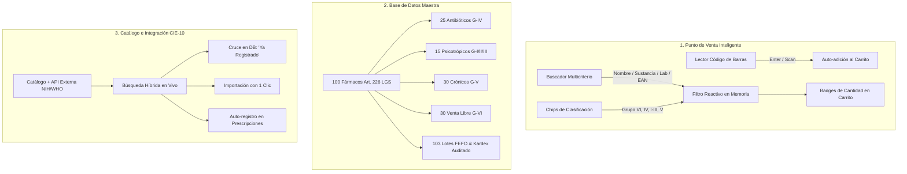

# Reporte Oficial de Cambios y Actualización: FarmaControl v1.0.0

**Fecha:** 26 de Octubre de 2026  
**Proyecto:** FarmaControl (Sistema Integral de Gestión Farmacéutica y Punto de Venta)  
**Versión Liberada:** `v1.0.0`  
**Ubicación Principal de Ejecución:** `C:\Developer` (Ruta Git Bash: `/c/Developer`)  

---

## 1. Resumen Ejecutivo de la Sesión

En esta sesión se cumplieron satisfactoriamente los tres objetivos planteados por el usuario mediante una arquitectura de **3 sub-agentes modulares**, además de establecer el **histórico de versiones estandarizado (SemVer 2.0.0)** y resolver permanentemente el acceso al ejecutable de Flutter en Git Bash.



---

## 2. Inventario Detallado de Cambios por Componente

### A. Sub-Agente 1: Punto de Venta y Búsqueda en Mostrador ([`pos_screen.dart`](file:///c:/Users/ybis/OneDrive/Documentos/Ingenieria%20en%20Sistemas/Developer/frontend/lib/screens/pos_screen.dart))
* **Buscador Reactivo Multicriterio:**
  * Búsqueda en tiempo real sobre `nombre_comercial`, `sustancia_activa`, `codigo_barras` y `laboratorio`.
  * Botón integrado de limpieza inmediata (`X`).
* **Soporte para Pistola / Escáner de Código de Barras:**
  * Detección por evento `onSubmitted` al recibir la lectura de una pistola óptica o pulsar `Enter`.
  * Si el código existe y tiene stock disponible: se agrega automáticamente al carrito, muestra un aviso flotante verde (*"¡Añadido: [Nombre]!"*) y borra el campo para que el cajero pueda escanear de corrido.
* **Filtros Rápidos Sanitarios (ChoiceChips):**
  * `Todos`, `Venta Libre (Grupo VI)`, `Antibióticos (Grupo IV)`, `Controlados (Grupo I-III)`, `Crónicos (Grupo V)` y `Solo con Stock`.
* **Indicadores Visuales de Mostrador:**
  * Badge interactivo en cada tarjeta indicando si el producto ya está en el ticket (`🛒 X en carrito`).
  * Contador dinámico: *"Mostrando X de 100 medicamentos"*.
  * Estado vacío con botón para restablecer filtros si no hay coincidencias.

---

### B. Sub-Agente 2: Catálogo Maestro de 100 Medicamentos ([`catalogo_medicamentos.py`](file:///c:/Users/ybis/OneDrive/Documentos/Ingenieria%20en%20Sistemas/Developer/backend/app/catalogo_medicamentos.py) y [`seed.py`](file:///c:/Users/ybis/OneDrive/Documentos/Ingenieria%20en%20Sistemas/Developer/backend/seed.py))
* **100 Fármacos Reales Mexicanos clasificados bajo norma COFEPRIS / LGS:**
  * **25 Antibióticos (Grupo IV - Requieren Receta):** Amoxicilina, Amoxicilina/Clavulánico, Ciprofloxacino, Azitromicina, Ceftriaxona 1g IM, Cefalexina, Claritromicina, Levofloxacino, Trimetoprima/Sulfametoxazol, Doxiciclina, Nitrofurantoína, Clindamicina, Metronidazol, Ampicilina, Gentamicina, Eritromicina, Cefuroxima, Fosfomicina, Minociclina, Dicloxacilina, Cefixima, Ofloxacino, Penicilina G Benzatínica, colirios antibióticos Sophia.
  * **15 Controlados y Psicotrópicos (Grupos I, II y III - Receta Retenida):** Clonazepam, Alprazolam, Diazepam, Lorazepam, Tramadol, Tramadol/Paracetamol, Pregabalina 75mg y 150mg, Gabapentina, Metilfenidato (Ritalin), Zolpidem, Modafinilo, Fentanilo en parches, Buprenorfina, Bromazepam.
  * **30 Crónicos y Especializados (Grupo V):** Losartán, Telmisartán, Enalapril, Amlodipino, Captopril, Metoprolol, Candesartán, Hidroclorotiazida, Furosemida, Espironolactona; Metformina, Glibenclamida, Dapagliflozina (Forxiga), Empagliflozina (Jardianz), Sitagliptina (Januvia), Insulinas NPH y Glargina (Lantus); Atorvastatina, Rosuvastatina, Bezafibrato; Salbutamol aerosol, Symbicort, Fluticasona nasal, Montelukast; Levotiroxina y Alopurinol.
  * **30 Venta Libre (Grupo VI - OTC):** Paracetamol (tabletas, solución y gotas), Ibuprofeno (400mg, 600mg), Naproxeno, Ketorolaco sublingual, Diclofenaco, Meloxicam, Celecoxib; Omeprazol, Pantoprazol, Esomeprazol, Famotidina, Melox suspensión, Pepto-Bismol, Buscapina, Loperamida, Senósidos A-B; Loratadina, Cetirizina, Clorfenamina jarabe, Redoxon efervescente, Complejo B, Electrolitos suero oral, Pomada de Óxido de Zinc.
* **103 Lotes con Despacho FEFO y Kardex:**
  * Lotes asignados con fechas escalonadas entre 60 días y 2 años.
  * Generación automática de asientos inmutables en el Kardex contable (`ENTRADA_COMPRA` con referencia `SEED-100`).

---

### C. Sub-Agente 3: Catálogo Oficial CIE-10 y Registro Dinámico ([`catalogo_cie.py`](file:///c:/Users/ybis/OneDrive/Documentos/Ingenieria%20en%20Sistemas/Developer/backend/app/catalogo_cie.py), [`enfermedades.py`](file:///c:/Users/ybis/OneDrive/Documentos/Ingenieria%20en%20Sistemas/Developer/backend/app/routers/enfermedades.py) y [`enfermedades_screen.dart`](file:///c:/Users/ybis/OneDrive/Documentos/Ingenieria%20en%20Sistemas/Developer/frontend/lib/screens/enfermedades_screen.dart))
* **Servicio de Terminología Médica CIE-10:**
  * Base de datos local con más de 80 diagnósticos clínicos prevalentes en México.
  * Conector a la API de terminología médica de **NIH Clinical Tables (ICD-10)** con tolerancia a fallos offline.
* **Nuevos Endpoints en Backend (FastAPI):**
  * `GET /api/enfermedades/catalogo-cie/buscar?q=...`: Búsqueda en vivo con el atributo booleano `ya_registrado`.
  * `POST /api/enfermedades/catalogo-cie/importar`: Importación de diagnósticos con 1 solo clic sin riesgos de duplicación.
  * `POST /api/enfermedades/auto-registrar`: Adición dinámica durante prescripciones o ventas.
* **Nueva Pantalla de Enfermedades con Pestañas:**
  * **Pestaña 1:** "Mis Diagnósticos en Farmacia" con buscador local y formulario manual asistido.
  * **Pestaña 2:** "Catálogo Oficial CIE-10" con buscador global, tarjetas clínicas con recomendaciones y botón turquesa `+ Agregar a Farmacia`.
  * **Botón "Completar":** En el diálogo de nuevo diagnóstico, al escribir un código como `J00`, `E11` o `I10`, autocompleta la descripción, categoría y consideraciones sanitarias.

---

### D. Historial de Versiones Formal ([`CHANGELOG.md`](file:///c:/Users/ybis/OneDrive/Documentos/Ingenieria%20en%20Sistemas/Developer/CHANGELOG.md))
* Creación del archivo formal bajo los estándares **Keep a Changelog** y **SemVer 2.0.0**.
* Registro del ciclo completo de vida del sistema:
  * **`v1.0.0` (2026-10-26):** Versión mayor actual con Búsqueda POS, 100 medicamentos y API CIE-10.
  * **`v0.3.0` (2026-10-25):** Turnos de caja, Cortes Z, Tickets térmicos de 80mm y Mermas sanitarias.
  * **`v0.2.0` (2026-10-24):** Despacho FEFO, Kardex inmutable y candado de antibióticos.
  * **`v0.1.0` (2026-10-23):** Arquitectura base, SQLite, FastAPI y Flutter Web.
* **Etiquetado Git:** Repositorio en `C:\Developer` inicializado con tag oficial `v1.0.0`.

---

### E. Entorno de Terminal y Ejecución
* **Solución de `bash: flutter: command not found`:**
  * Configuración en `~/.bashrc` y `~/.bash_profile` agregando permanentemente `/c/Users/ybis/flutter/bin` al `PATH`.
* **Sincronización Total de Archivos:**
  * Código fuente de frontend, backend y base de datos `farmacia.db` sincronizados idénticamente entre el workspace de trabajo y el entorno de compilación `C:\Developer`.

---

## 3. Matriz de Resultados de Pruebas

| Prueba Ejecutada | Entorno | Resultado |
| :--- | :--- | :--- |
| **`python seed.py`** | SQLite | ✅ 100 Medicamentos y 103 Lotes sembrados con éxito. |
| **`python test_api.py`** | FastAPI (TestClient) | ✅ **9/9 Pruebas superadas (100%)** incluyendo búsqueda e importación CIE. |
| **`flutter analyze`** | Flutter Web | ✅ **0 Errores de sintaxis o tipos**. |
| **Git Repos & Tags** | `C:\Developer` y Workspace | ✅ Tag `v1.0.0` registrado y `CHANGELOG.md` confirmado. |

---

## 4. Guía Rápida para Probar los Cambios en Vivo

### Comandos de Arranque (en Git Bash):

* **Terminal 1 — Backend:**
  ```bash
  cd /c/Developer/backend
  python run.py
  ```

* **Terminal 2 — Frontend:**
  ```bash
  cd /c/Developer/frontend
  flutter run -d web-server --web-port=8080
  ```
  *(Abre en tu navegador [http://localhost:8080](http://localhost:8080))*

---

### Recorrido de Pruebas Recomendado:

1. **Búsqueda en POS:**
   * Ve a **Cobrar**. En la barra superior escribe `amox` o `metformina` y observa el filtrado instantáneo.
   * Presiona el chip `Antibióticos (Grupo IV)` para aislar sólo los productos que exigen receta médica.
2. **Prueba de Lector de Código de Barras:**
   * En el campo de búsqueda escribe `750100000001` y presiona `Enter`.
   * Observa cómo se agrega de inmediato el *Paracetamol 500mg* al ticket y aparece el badge `🛒 1 en carrito`.
3. **Explorador y Alta de Diagnósticos CIE-10:**
   * Entra a la sección **Enfermedades** y haz clic en la pestaña **Catálogo Oficial CIE-10**.
   * Busca `asma`, `gastritis` o `J18` (Neumonía).
   * Pulsa el botón `+ Agregar a Farmacia` y regresa a la primera pestaña para verificar que ya está disponible para tus médicos y cajeros.
