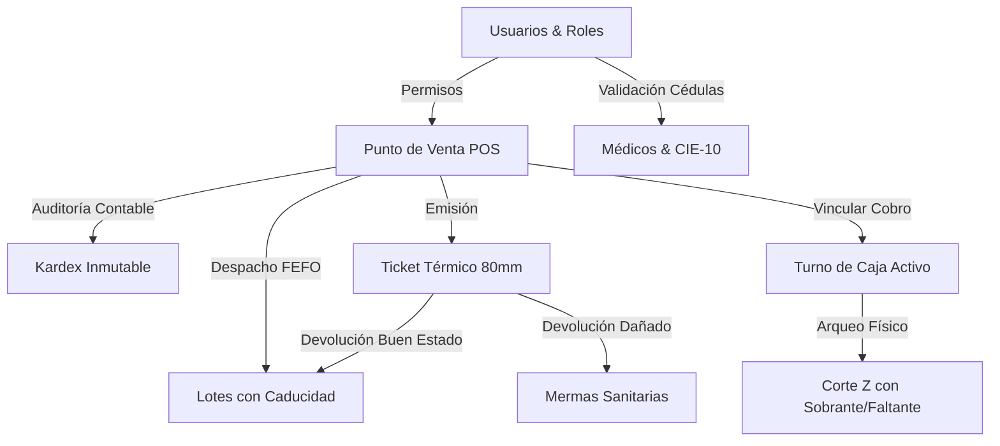

# Reporte Técnico y Guía de Pruebas: Sistema FarmaControl

**Fecha:** 25 de Octubre de 2026  
**Proyecto:** FarmaControl (Sistema Integral de Gestión Farmacéutica)  
**Ubicación Definitiva en Disco Local:** `C:\Developer` (Ruta Git Bash: `/c/Developer`)  

---

## 1. Resumen de Objetivos Alcanzados en la Sesión

En esta sesión completamos el **Paso 6** en su totalidad, robusteciendo la lógica regulatoria sanitaria mexicana (**FEUM / Art. 226 LGS / COFEPRIS**) y resolviendo de forma permanente el bloqueo de archivos de compilación al migrar el proyecto fuera de OneDrive hacia la ruta local `C:\Developer`.



---

## 2. Detalle de Módulos Implementados (Paso 6)

### A. 🔄 Flujo de Devoluciones y Mermas Sanitarias
* **Lógica Sanitaria:**
  * Si el medicamento se devuelve en **Buen Estado**: El backend incrementa automáticamente el `stock_actual` en el lote de origen y crea un registro en el Kardex inmutable como `ENTRADA_DEVOLUCION`.
  * Si el medicamento está **Dañado**: No regresa al stock disponible para venta (se aparta a cuarentena/destrucción) y genera un movimiento en Kardex como `SALIDA_MERMA`.
* **Endpoints:**
  * `POST /api/devoluciones/`: Procesamiento de devolución y cálculo automático del reembolso.
  * `GET /api/devoluciones/`: Historial de reembolsos emitidos.
  * `GET /api/devoluciones/mermas`: Bitácora sanitaria de productos dados de baja.
* **Interfaz:** Pestaña dedicada con vista de reembolsos y mermas, más un botón directo *"Devolución / Merma"* en cada ticket del historial.

### B. 🧾 Tickets Térmicos de Venta (58mm / 80mm)
* **Formato Realista:**
  * Membrete con RFC, Razón Social y Registro Sanitario COFEPRIS.
  * Metadatos: Folio único, Cajero, Comprador y Médico con cédula profesional validada (si se surtió fármaco controlado).
  * **Trazabilidad FEFO obligatoria:** Desglose del número de lote y fecha de vencimiento asignados a cada producto.
  * Desglose financiero: Subtotal, Descuento, Total, Forma de Pago (Efectivo/Tarjeta/Transferencia), Paga Con y Cambio.
  * Código de barras y leyenda oficial del Art. 226 de la Ley General de Salud.
* **Funciones:** Se despliega al terminar una venta en el POS y cuenta con botones de **"Imprimir Ticket"** y **"Copiar Ticket"** (texto plano para impresoras térmicas ESC/POS).

### C. 💰 Cortes de Caja y Arqueo de Turnos (Corte Z)
* **Control de Gaveta:**
  * `POST /api/caja/abrir`: Apertura de turno registrando cajero y fondo inicial de cambio ($ MXN).
  * `GET /api/caja/resumen`: Arqueo en vivo con cálculo en tiempo real del efectivo esperado en gaveta (`Fondo Inicial + Ventas Efectivo`).
  * `POST /api/caja/cerrar`: Conteo de dinero físico con detección instantánea de **Sobrante (+)** o **Faltante (-)** y generación del comprobante de cierre (Corte Z).
* **Punto de Venta:** Selector de método de pago con botones rápidos ($100, $200, $500, $1000, Exacto) y cálculo automático del cambio.

### D. 🔐 Autenticación y Matriz de Roles
* **Base de Datos y API:**
  * Tabla `usuarios` con hash SHA-256 de contraseña y roles definidos.
  * Endpoints `POST /api/auth/login`, `GET /api/auth/usuarios` y `GET /api/auth/roles`.
* **Perfiles Precargados para Pruebas:**

| Usuario | Contraseña | Rol | Permisos Clave |
| :--- | :--- | :--- | :--- |
| **`admin`** | `admin123` | `ADMINISTRADOR` | Acceso completo, arqueos generales, reportes y anulación. |
| **`cajero`** | `caja123` | `CAJERO` | Cobro en mostrador, apertura y corte personal de turno. |
| **`sanitario`** | `resp123` | `RESPONSABLE_SANITARIO` | Validación de cédulas médicas, autorización de antibióticos y auditoría de recetas. |

* **Interfaz:** Menú desplegable en la barra superior de la aplicación para alternar instantáneamente de rol durante las pruebas.

---

## 3. Comandos de Arranque Rápido para Mañana

Abre dos terminales de **Git Bash** en VS Code:

### Terminal 1 — Backend (FastAPI):
```bash
cd /c/Developer/backend
python run.py
```
> **Verificación:** Visita [http://127.0.0.1:8000/docs](http://127.0.0.1:8000/docs) para ver Swagger UI interactivo con los 25+ endpoints.

### Terminal 2 — Frontend (Flutter Web Server):
```bash
cd /c/Developer/frontend
flutter run -d web-server --web-port=8080
```
> **Acceso:** Abre tu navegador favorito (Chrome, Edge o Firefox) en:  
> 👉 **`http://localhost:8080`**

---

## 4. Matriz de Pruebas Funcionales Sugeridas para Mañana

> [!TIP]
> Puedes realizar este recorrido paso a paso para verificar el ciclo de vida completo de la farmacia:

1. **Prueba de Cobro con Cambio (Venta Libre):**
   * Ve a **Cobrar**, agrega 2 cajas de *Paracetamol 500mg* ($90.00 MXN).
   * Selecciona método de pago *Efectivo* y presiona el botón rápido de *$100*.
   * Verifica que marque *$10.00 MXN de cambio*.
   * Presiona *Cobrar e Imprimir Ticket* y comprueba que se abra el modal térmico con los lotes FEFO desglosados.

2. **Prueba de Candado Regulatorio (Antibióticos Grupo IV):**
   * Agrega *Amoxicilina 500mg* al carrito sin seleccionar médico.
   * Intenta cobrar y confirma que el sistema bloquee la venta exigiendo un médico con cédula profesional vigente.
   * Selecciona al *Dr. Roberto Carlos Hernández* y autoriza el despacho.

3. **Prueba de Devolución Sanitaria:**
   * Ve a la sección **Ventas**, localiza el ticket emitido y pulsa **"Devolución / Merma"**.
   * Devuelve 1 pieza en condición **"Buen Estado"**: verifica en la pestaña **Inventario** que el stock del lote vuelva a subir.
   * Devuelve otra pieza en condición **"Dañado"**: verifica en la sección **Devoluciones** que se registre en la bitácora de **Mermas Sanitarias**.

4. **Prueba de Arqueo y Corte Z:**
   * Entra a la sección **Corte Caja**.
   * Observa los KPIs del turno matutino (Fondo inicial de $1,000 + ventas en efectivo registradas).
   * Pulsa **Corte Z / Arqueo**, ingresa el dinero físico contado y observa el semáforo de cuadre (Exacto, Sobrante o Faltante) antes de cerrar el turno.

5. **Prueba de Cambio de Rol:**
   * Haz clic en el chip de usuario en la barra superior y cambia de `Lic. Alejandro Mendoza (ADMINISTRADOR)` a `Dra. Carmen Sofía Morales (RESPONSABLE_SANITARIO)` para probar las facultades de auditoría médica.
