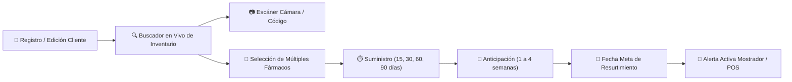

# Reporte Técnico de Actualización - FarmaControl v1.4.7

**Fecha:** 3 de Noviembre de 2026  
**Rama Git:** `main`  
**Versión:** `v1.4.7`  
**Estado de Despliegue:** Producción lista (Web / PWA / Android)  
**URL de Producción (GitHub Pages):** [https://ybisjuxx.github.io/Developer/](https://ybisjuxx.github.io/Developer/)  
**Backend API (Render Cloud):** [https://developer-80fs.onrender.com/](https://developer-80fs.onrender.com/)

---

## 1. Resumen Ejecutivo de la Versión

En cumplimiento a la solicitud de optimización del **módulo de clientes y seguimiento crónico**, FarmaControl v1.4.7 introduce la **integración bidireccional con el inventario de la farmacia** para la prescripción de medicamentos recurrentes, junto con un **sistema reconfigurable de recordatorios con anticipación semanal (1 a 4 semanas)**.

Los farmacéuticos y cajeros ahora cuentan con un motor interactivo de búsqueda de fármacos con autocompletado en tiempo real, lector óptico de códigos de barras mediante la cámara del dispositivo móvil o PC, soporte multi-medicamento y filtros rápidos en cabecera para identificar proactivamente qué pacientes deben resurtirse antes de que agoten su tratamiento.

---

## 2. Novedades y Mejoras Implementadas

### A. Buscador de Medicamentos Conectado al Inventario Real
- **Autocompletado en Tiempo Real:** Campo de búsqueda interactivo que consulta la existencia local (`ApiService.getProductos()`) filtrando por nombre comercial, sustancia activa (fórmula) o código de barras mientras se escribe.
- **Detalle de Stock y Presentación:** Despliega en vivo sugerencias con existencias actuales (`Stock: X pzas`), forma farmacéutica y laboratorio fabricante.
- **Escáner Óptico con Cámara Móvil (`LectorCodigoBarrasDialog`):** Botón táctil para enfocar la cámara del teléfono o tableta sobre la caja del medicamento físico; identifica el producto en almacén y lo incorpora a la lista de tratamiento.
- **Soporte Multi-Fármaco:** Permite agregar múltiples medicamentos a la rutina de resurtimiento del paciente mediante chips interactivos con eliminación individual (❌).
- **Entrada Flexible / Texto Libre:** Admite incorporar tratamientos personalizados aunque el medicamento aún no esté cargado en el inventario.

### B. Configuración de Recordatorios con Semanas de Anticipación
- **Presets de Suministro:** Atajos rápidos de duración de tratamiento (`15 días`, `30 días [1 mes]`, `60 días [2 meses]`, `90 días [3 meses]`) y campo numérico para días a la medida.
- **Selector de Anticipación de Alerta:** Control explícito para programar con cuántas semanas de anticipación avisar al mostrador y al paciente:
  - `1 semana (7 días antes)`
  - `2 semanas (14 días antes)`
  - `3 semanas (21 días antes - Estándar recomendado)`
  - `4 semanas (28 días antes - 1 mes)`
- **Fecha Meta de Próximo Resurtimiento:** Selección mediante calendario interactivo (`showDatePicker`) o recálculo automático instantáneo (`Hoy / Última visita + Días de suministro`).
- **Panel Dinámico de Resumen:** Muestra en tiempo real la fecha estimada de agotamiento, días restantes y la fecha exacta de inicio del recordatorio preventivo.

### C. Filtros Rápidos y Colorimetría en Mostrador
En la cabecera del Padrón de Clientes se integraron chips de filtrado con recuento en vivo:
1. `Todos (N)`: Lista global de clientes registrados.
2. `⚠️ Próximos a Resurtir (N)`: Aísla a los pacientes que han entrado en la ventana de anticipación programada para llamada o mensaje preventivo.
3. `🚨 Resurtimiento Vencido (N)`: Filtra a los pacientes cuyo suministro ya concluyó para seguimiento urgente de adherencia terapéutica.
4. `🟢 Tratamiento al Día (N)`: Pacientes con tratamiento vigente fuera de la ventana de alerta.
5. `💊 Crónicos Totales (N)`: Universo total de pacientes con padecimientos crónicos.

---

## 3. Verificación Técnica y Calidad

| Prueba / Componente | Resultado | Detalle |
| :--- | :---: | :--- |
| **Backend Unit & Integration Tests** | ✅ Aprobado | 28/28 pruebas superadas al 100% (`test_api.py`). |
| **Flutter Analyze** | ✅ Aprobado | 0 errores en `clientes_screen.dart`. |
| **Flutter Web Build Release** | ✅ Aprobado | Compilación exitosa en 52.3s con base-href `/Developer/`. |
| **Compatibilidad Móvil / Vertical** | ✅ Aprobado | Diseño adaptativo con `SingleChildScrollView`, `Wrap` y badges responsivos sin desbordamiento. |

---

## 4. Archivos Modificados

- [`frontend/lib/screens/clientes_screen.dart`](file:///c:/Users/ybis/OneDrive/Documentos/Ingenieria%20en%20Sistemas/Developer/frontend/lib/screens/clientes_screen.dart): Buscador conectado al inventario, cámara barcode, chips multi-medicamento, selector de semanas de anticipación y barra de filtros rápidos.
- [`backend/app/models.py`](file:///c:/Users/ybis/OneDrive/Documentos/Ingenieria%20en%20Sistemas/Developer/backend/app/models.py): Campo `medicamento_cronico_principal` ampliado a `Text`, cálculo de alertas hasta 4 semanas de anticipación y formateo de semanas restantes en alertas.
- [`backend/app/routers/clientes.py`](file:///c:/Users/ybis/OneDrive/Documentos/Ingenieria%20en%20Sistemas/Developer/backend/app/routers/clientes.py): Cálculo automático y preservación de `fecha_proximo_resurtimiento`.
- [`CHANGELOG.md`](file:///c:/Users/ybis/OneDrive/Documentos/Ingenieria%20en%20Sistemas/Developer/CHANGELOG.md): Registro oficial de cambios de la versión 1.4.7.
